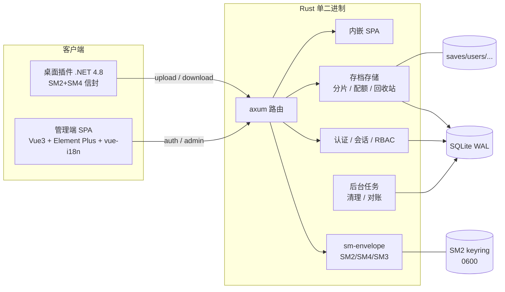

# DSP 云存档服务 Rust 重构 + 国密管理端 实现方案

> **已废弃（v1）**：请以 `docs/rust-rewrite-and-sm-crypto-plan-v2.md` 为准。v1 中的 SQLite、邮箱验证、dual 过渡等决策已被推翻。

> 范围：`services/acc`（Node/Express + MongoDB 后端）、新增管理端（注册用户 / 登录 / 存档管理 / 中英切换）、密码传输国密改造、Rust 全量重写。
> 目标读者：后端、前端、客户端（C# 插件）开发者与运维。
> 版本：v1.0 / 2026-10-17

---

## 0. 结论先行

1. **现状必须改**：当前后端把密码明文放在每个请求体里（连下载、上传分片都带），中间件还会把整个请求体打进日志；没有任何会话令牌、没有管理员概念、没有配额与审计。国密改造不是"加一层"，而是要把认证模型一起换掉。
2. **国密方案按参考实现逐字节还原**：SM2（C1C3C2，未压缩点，hex）加密一个随机 32 位 hex 的 SM4 密钥，SM4-ECB/PKCS#7 加密密码，密文放 `password` 字段，SM2 密文放 `smkey` 请求头。服务端生成并持久化 SM2 密钥对。
3. **最大的落地风险不是算法，而是兼容性**：桌面端 `DSPRemoteSaves.cs` 目前每个请求都发明文密码。强制国密后老客户端必然 401。必须同一版本升级 C# 客户端，或保留一个可配置的 `AUTH_MODE=dual` 过渡窗口。
4. **建议架构**：Rust `axum` + `tokio` + `sqlx/SQLite`（单二进制、无外部数据库）+ 内嵌 Vue 3 管理端；保留 `/dsp.saves/api` 老路径与老 JSON 结构，新增 `/auth/*` 与 `/admin/*`。
5. **国密加密不能替代 TLS**：它解决的是"密码不以明文出现在请求体/日志/抓包里"，不解决整条链路的机密性与完整性。生产必须上 HTTPS；如要过密评，还需 TLCP（国密 TLS）与密码机。

**需要先确认的 5 个决策**（见 §11）：数据库选型、老客户端升级窗口、是否过密评、管理端是否公网、是否保留 `/users/*` 老接口。

---

## 1. 现状分析

### 1.1 服务拓扑

```
Unity 游戏 (BepInEx 插件, .NET Framework 4.8)
        │  HTTP  :9999  明文 JSON / 二进制分片
        ▼
Node 20 + Express 5 (services/acc, TypeScript → dist)
        │
        ├── MongoDB  DSPCloudSaves.users
        └── 本地磁盘  saves/temp/<fileId>/   saves/users/<userName>/*.dsv
```

代码量很小：`src/` 5 个文件、约 1500 行；`dist/` 是编译产物。服务只做三件事：用户校验、分片上传、按用户列目录/下载。

### 1.2 数据模型

Mongo `users` 集合（无 schema）：

```json
{
  "userName": "aims",
  "password": "$2b$10$...",   // bcrypt, cost=10
  "cache": {},                 // 实际未使用
  "login": false               // 仅登录标记，未参与任何鉴权
}
```

磁盘：

```
saves/
├── temp/<fileId>/<index>.chunk      // 上传会话临时分片，进程重启即清空
└── users/<userName>/<fileName>      // 用户存档，目录名直接取自 userName
```

### 1.3 接口清单与调用方

| 路径 | 方法 | 鉴权方式 | 桌面端是否调用 |
|---|---|---|---|
| `/users/create` | POST | **无** | 否 |
| `/users/login` | POST | 明文账号密码 | 否 |
| `/users/logout` | POST | 明文账号密码 | 否 |
| `/users/update` | POST | 明文旧密码 | 否 |
| `/users/delete` | POST | 明文密码 | 否 |
| `/upload/init` | POST | 明文账号密码 | **是** |
| `/upload/chunk` | POST | 仅 fileId（无属主校验） | **是** |
| `/upload/complete` | POST | 仅 fileId | **是** |
| `/download/file-list` | POST | 明文账号密码 | **是** |
| `/download/download` | POST | 明文账号密码 | **是** |

关键事实：**桌面端从不调用 `/users/login`**，它在每个请求里重复携带 `userName + password`。所以：

- `/users/*` 这组接口目前没有真实调用方，可以自由重构；
- 真正的兼容面只有 5 个上传/下载接口；
- "强制国密"必须改这 5 个接口的请求格式，客户端不改就不可能继续工作。

### 1.4 现有实现问题

| 级别 | 位置 | 问题 | 影响 |
|---|---|---|---|
| 严重 | `index.ts:157-164` | 中间件 `console.log(request.url, request.body)` | 明文密码直接进日志 |
| 严重 | 全链路 | 密码随每次请求传输，无 TLS 强制 | 局域网抓包即得凭据 |
| 严重 | 整体 | 无会话 / 无令牌 / 无角色 | 无法审计、无法踢人、无法最小权限 |
| 高 | `index.ts:601` | `/users/create` 无任何鉴权 | 任何人可注册账号占用磁盘 |
| 高 | `server.ts:23-26` | `cors({ origin: "*" })` | 任意网页可驱动 API |
| 高 | 整体 | 无限流、无失败锁定 | 可在线爆破 |
| 高 | 整体 | 无每用户配额、无磁盘余量检查 | 磁盘可被打满 |
| 中 | `index.ts:99` | `bcrypt.compareSync` 在事件循环里同步执行 | 并发登录时阻塞 |
| 中 | `index.ts:115-121` | 上传会话只在内存，启动时 `rm -rf temp` | 重启即丢会话，无法续传 |
| 中 | `index.ts:384` | 目录名直接来自 `userName`，仅 `path.basename` | Windows 保留名/超长名/大小写冲突 |
| 中 | `index.ts:286-300` | 分片接口只认 `fileId` | 拿到 fileId 即可污染他人上传 |
| 中 | 整体 | 覆盖存档前无备份、无版本 | 误覆盖不可恢复 |
| 低 | `index.ts:759` | 登录失败返回 `code: 0` | 客户端误判成功 |
| 低 | `index.ts:795` | 已登出时 `modifiedCount=0` 返回 500 | 语义错误 |
| 低 | 整体 | 无健康检查、无指标、无 traceId | 排障靠翻日志 |

> 这些不是"顺手优化"，其中 5 条直接决定国密改造能否通过安全验收。

---

## 2. 需求拆解与约束

### 2.1 功能需求

| 编号 | 需求 | 说明 |
|---|---|---|
| F1 | 管理端登录 | 管理员账号密码登录，SM2/SM4 加密传输 |
| F2 | 用户注册 | 管理员在后台创建用户、设置初始密码/配额/角色；可选开放自助注册（默认关） |
| F3 | 用户登录 | 普通用户登录后只能看到自己的存档 |
| F4 | 存档管理 | 按用户浏览、下载、上传/覆盖、重命名、删除、批量删除、容量统计 |
| F5 | 语言切换 | 中/英双语，界面即时切换并持久化，接口错误消息同步本地化 |
| F6 | 审计 | 登录、注册、改密、删除、下载等关键操作留痕，可查询/导出 |
| F7 | 兼容 | 老桌面端在过渡期内可继续上传/下载 |

### 2.2 强制需求

| 编号 | 需求 | 验收方式 |
|---|---|---|
| M1 | 密码传输必须 SM2 + SM4 组合加密 | 抓包与日志中不出现明文；见 §8.1 用例 |
| M2 | 服务端生成并保存一组 SM2 密钥对 | 首次启动生成，重启后公钥不变，私钥文件权限 600 |
| M3 | 加密方式与 `get-login-token.mjs` 一致 | JS ↔ Rust 双向互通测试向量全部通过 |
| M4 | 使用 Rust 全量重写后端 | 交付单一 Rust 二进制，不再依赖 Node/Mongo（若选 SQLite） |
| M5 | 语言切换 | 中英词条 100% 覆盖，刷新后保持 |

### 2.3 兼容性约束（必须写进排期）

- 桌面端是 Unity/BepInEx 插件，**无法静默升级**，只能随插件版本发布。
- 服务端一旦切 `AUTH_MODE=strict`，所有旧版插件立即失效。
- 建议策略：
  - `AUTH_MODE=dual`：同时接受"带 `smkey` 头"和"明文密码"，明文请求返回 `Warning: 299 - "plaintext auth deprecated"` 并计入审计；
  - 观察 2~4 周，确认旧版本客户端占比降到可接受范围后切 `strict`；
  - 管理端与 `/auth/*` **永远只接受密文**，不受 `dual` 影响。

---

## 3. 国密方案（核心）

### 3.1 参考实现的逐字节还原

`get-login-token.mjs` 的流程（与 `src/utils/crypto.js`、`src/utils/utils.js` 一致）：

```
1. POST /upms/sm/publicKey          → data = "04..."（未压缩公钥 hex，可能包在数组里）
2. sm4Key = 16 字节随机数 → 32 位小写 hex 字符串
3. smkey  = SM2_doEncrypt(sm4Key 这个"字符串", publicKey, cipherMode=1)  → hex
4. password_cipher = SM4_ECB_PKCS7(明文密码, key=hexToBytes(sm4Key))     → hex
5. POST /upms/account/login
   header: smkey: <SM2 密文 hex>
   body:   { account, password: <SM4 密文 hex>, timestamp: Date.now() }
```

字节级约定（这是互通的全部关键）：

| 项 | 约定 | 备注 |
|---|---|---|
| 曲线 | `sm2p256v1`（GM/T 0003） | — |
| SM2 密文布局 | **C1C3C2**（`cipherMode=1`） | 与 `sm-crypto` 默认相反，必须显式指定 |
| C1 编码 | 未压缩点 `04 || X(32) || Y(32)` | 共 65 字节，hex 以 `04` 开头 |
| SM2 明文 | **SM4 密钥的 32 位 hex 字符串（32 字节 ASCII）** | 不是 16 字节裸密钥，最容易踩坑 |
| SM4 模式 | **ECB**，PKCS#7 填充 | `sm4.encrypt` 不传 `mode` 即 ECB |
| SM4 密钥 | 16 字节，hex 解码后使用 | `sm-crypto` 对字符串 key 走 `hexToArray` |
| 密文编码 | 小写 hex | 大小写不影响解析，但统一小写 |
| 传输位置 | SM2 密文放请求头 `smkey`，SM4 密文放 body 的密码字段 | 与参考实现一致 |

> 注意两个"反直觉"点：
> 1. 参考实现加密的是 **32 字符 hex 文本**，服务端解出来必须先当字符串、再 `hex::decode` 成 16 字节，否则密钥长度永远不对。
> 2. `sm-crypto` 的 `sm4.encrypt(plain, key)` **默认就是 ECB**（源码里只有 `mode === 'cbc'` 才走 CBC），不要被某些文档误导。

### 3.2 服务端 SM2 密钥对

**生成时机**：进程启动时检查 `SM2_KEY_DIR`，不存在则生成；已存在则加载。绝不把密钥写进代码、镜像或仓库。

```
data/keys/
├── keyring.json                 # { "active": "a1b2c3d4", "keys": ["a1b2c3d4", ...] }
├── sm2-a1b2c3d4.priv.pem        # PKCS#8，权限 0600（Windows: 仅服务账号 ACL）
└── sm2-a1b2c3d4.pub.hex         # 04||X||Y，供运维核对/下发
```

- `keyId` = `hex(sha256(pub)[..8])`，随公钥一起返回，客户端可缓存。
- **口令保护（推荐）**：设置 `SM2_KEY_PASSPHRASE` 时，私钥用 `argon2id` 派生密钥 + `chacha20poly1305` 加密落盘；未设置时仅依赖文件权限，并在启动日志打 `WARN`。
- **轮换**：`POST /admin/crypto/rotate`（需管理员 + 二次确认）。新密钥置为 active，旧密钥保留 `SM2_KEY_GRACE_HOURS`（默认 24h），客户端带未知 `keyId` 时返回 `2005 SM_KEY_UNKNOWN` 触发重新拉取。
- **多实例**：密钥目录必须是共享卷或改用 KMS/HSM；否则每个实例公钥不同，负载均衡后会随机失败。

Rust 侧生成（`sm2` crate，需 `pke`/`getrandom` feature）：

```rust
use sm2::{SecretKey, pke::{DecryptingKey, Mode}};
use sm2::elliptic_curve::Generate;

let sk = SecretKey::generate();
// 未压缩点 04||X||Y；具体方法名以锁定的 crate 版本为准
let pub_hex = hex::encode(sk.public_key().to_sec1_point(false).as_bytes());
let key_id   = hex::encode(&sha2::Sha256::digest(pub_hex.as_bytes())[..8]);
```

### 3.3 协议设计（v1 信封）

**公钥接口**

```http
GET /dsp.saves/api/crypto/public-key
200
{
  "code": 0,
  "payload": {
    "keyId": "a1b2c3d4e5f60718",
    "publicKey": "04....",
    "sm2Mode": "C1C3C2",
    "sm4Mode": "ECB/PKCS7",
    "serverTime": 1760707200000
  }
}
```

`serverTime` 用于客户端校正时钟（时间戳容差 300s）。兼容旧前端可再提供 `POST /upms/sm/publicKey` 形态 `{ code: 0, data: ["04..."] }`，但新代码不应依赖。

**登录**

```http
POST /dsp.saves/api/auth/login
smkey: <SM2 密文 hex>
smkey-id: a1b2c3d4e5f60718        (可选)
Content-Type: application/json

{ "account": "admin", "password": "<SM4 密文 hex>", "timestamp": 1760707200000, "nonce": "9f2c..." }
```

```json
{
  "code": 0,
  "payload": {
    "token": "v1_9xQ...",
    "expiresAt": 1760750400000,
    "user": { "id": "u_...", "userName": "admin", "role": "admin", "locale": "zh-CN", "mustChangePassword": false }
  }
}
```

**注册 / 重置密码 / 改密**：同一个信封，只是字段不同。

| 场景 | 接口 | 密文字段 |
|---|---|---|
| 管理员创建用户 | `POST /admin/users` | `password` |
| 管理员重置密码 | `POST /admin/users/{id}/reset-password` | `password` |
| 用户改密 | `POST /auth/password` | `password`（旧）、`newPassword`（新），共用同一个 `smkey` |

> 一个 `smkey` 可以加密多个字段：SM4 密钥是请求级的，不是字段级的。前端封装成 `seal(["old","new"])`。

### 3.4 防重放

参考脚本只带了 `timestamp`，服务端没有校验。同一份密文可以无限重放（SM2 每次都能解出同一个 SM4 密钥），必须补：

1. `|serverNow - timestamp| <= 300_000ms`，否则 `2003`；时间戳兼容秒/毫秒（`< 1e12` 视为秒）。
2. 重放键 = `SM3(smkey)`（`nonce` 存在时 = `SM3(nonce || smkey)`），写入带 TTL 的缓存（`moka`，10 分钟）；命中则 `2004`。
3. 缓存上限 10 万条，按 LRU 淘汰；单实例足够，多实例需换 Redis。
4. 校验顺序：**先验时间戳 → 再查重放 → 再 SM2 解密 → 再 SM4 解密 → 再验密码**，避免对攻击者做无谓的椭圆曲线运算。

### 3.5 Rust 解密实现

```rust
use cipher::{BlockDecryptMut, KeyInit, block_padding::Pkcs7};
use sm2::pke::{DecryptingKey, Mode};
use sm4::Sm4;

pub fn open_envelope(
    ring: &KeyRing,
    key_id: Option<&str>,
    smkey_hex: &str,
    password_hex: &str,
) -> Result<String, CryptoError> {
    // 1) SM2 解密，得到 32 字节 ASCII：SM4 密钥的 hex 文本
    let key = ring.get(key_id)?; // 未知 keyId → SM_KEY_UNKNOWN
    let dk = DecryptingKey::new_with_mode(key.to_nonzero_scalar(), Mode::C1C3C2);
    let key_hex_bytes = dk.decrypt(&hex::decode(smkey_hex)?)?;
    let key_hex = std::str::from_utf8(&key_hex_bytes)?;

    // 2) 32 位 hex → 16 字节
    let key_bytes: [u8; 16] = hex::decode(key_hex)?.try_into()
        .map_err(|_| CryptoError::BadSm4Key)?;

    // 3) SM4-ECB/PKCS7 解密
    let mut buf = hex::decode(password_hex)?;
    let cipher = ecb::Decryptor::<Sm4>::new_from_slice(&key_bytes)
        .map_err(|_| CryptoError::BadSm4Key)?;
    let plain = cipher
        .decrypt_padded_mut::<Pkcs7>(&mut buf)
        .map_err(|_| CryptoError::BadPadding)?;

    Ok(std::str::from_utf8(plain)?.to_owned())
}
```

依赖：`sm2 = { features = ["pke", "getrandom"] }`、`sm4`、`ecb`、`cipher`、`sm3`、`hex`、`sha2`。

**实现注意**：

- RustCrypto `sm2` 的 `pke` 输出的就是 `04||C1||C3||C2`（未压缩点 + C1C3C2），与 `sm-crypto` 对齐；仍建议用测试向量锁定，不要凭文档假设。
- SM4 解密后必须校验 UTF-8；非法字节直接拒绝，不要 `from_utf8_lossy`。
- 解出的明文密码用 `secrecy::SecretString` 包裹，禁止 `Debug`/日志输出。
- 椭圆曲线运算约 1~3ms，可接受；但应在 `spawn_blocking` 里做，避免占满 async worker（高并发登录时）。

### 3.6 C# 桌面端改造

`DSPRemoteSaves.cs` 目前每个请求都带明文密码。改造点集中在 `PostJson` 与 4 个请求模型：

1. 启动时（或首次请求）`GET /crypto/public-key`，缓存 `publicKey` + `keyId`。
2. 每次请求：
   - `RNGCryptoServiceProvider` 生成 16 字节 → 转 32 位 hex 作为 SM4 密钥；
   - `SM2Engine(Mode.C1C3C2)` 加密这 32 字节 ASCII；
   - `PaddedBufferedBlockCipher(SM4Engine, Pkcs7Padding)` 加密密码；
   - `smkey` 放请求头，`password` 放密文。
3. 收到 `2005`（keyId 失效）时刷新公钥并重试一次。
4. 密码不再进入任何日志。

BouncyCastle（`BouncyCastle.Crypto`，net48 可用）关键代码：

```csharp
static byte[] Sm2Encrypt(string pubHex, byte[] plain)
{
    var curve = GMNamedCurves.GetByName("sm2p256v1");
    var point = curve.Curve.DecodePoint(Hex.Decode(pubHex));
    var pub = new ECPublicKeyParameters(
        point, new ECDomainParameters(curve.Curve, curve.G, curve.N, curve.H));
    var engine = new SM2Engine(SM2Engine.Mode.C1C3C2);
    engine.Init(true, new ParametersWithRandom(pub, new SecureRandom()));
    return engine.ProcessBlock(plain, 0, plain.Length);
}

static string Sm4EcbHex(byte[] key, byte[] plain)
{
    var cipher = new PaddedBufferedBlockCipher(new SM4Engine(), new Pkcs7Padding());
    cipher.Init(true, new KeyParameter(key));
    var outp = new byte[cipher.GetOutputSize(plain.Length)];
    int len = cipher.ProcessBytes(plain, 0, plain.Length, outp, 0);
    len += cipher.DoFinal(outp, len);
    return BitConverter.ToString(outp, 0, len).Replace("-", "").ToLowerInvariant();
}
```

> .NET Framework 4.8 没有内置 SM2/SM4，只能引 BouncyCastle；`RNGCryptoServiceProvider` 不能换成 `Random`。

### 3.7 安全边界与合规

- **SM2/SM4 只保护"密码字段"**，不保护 token、不保护文件内容。管理端必须跑在 HTTPS 下；桌面端建议也走 HTTPS。
- **国密合规**：如果甲方要求"商用密码应用安全性评估（密评）"，纯软件 + 文件私钥通常不达标。需要：
  - TLCP（国密 TLS）网关：Tongsuo/铜锁 + Nginx，或商用密码机；
  - SM2 私钥放密码机/HSM，通过 SDF/SKF 接口调用；
  - 完整密钥管理制度（生成、分发、轮换、销毁、审计）。
  这些不在本次代码范围内，但**必须在方案评审时确认**，否则做完再改架构代价极大。
- **日志脱敏**：统一在 `tracing` 层做字段过滤，`password`、`smkey`、`authorization`、`token` 一律 `[REDACTED]`；禁止打印请求体。
- **错误消息**：登录失败统一返回"账号或密码错误"，不区分用户不存在/密码错，防枚举；同时对不存在用户执行一次假哈希，抹平时序差异。

### 3.8 与参考实现的差异（有意为之）

| 项 | 参考实现 | 本方案 | 原因 |
|---|---|---|---|
| 随机源 | `Math.random()` 生成 SM4 密钥 | CSPRNG（`crypto.getRandomValues` / `RNGCryptoServiceProvider`） | `Math.random` 可预测，等于白加密 |
| 防重放 | 仅 timestamp，服务端不校验 | timestamp ±300s + 重放缓存 | 密文可被原样重放 |
| 密钥标识 | 无 | `keyId` + 宽限期 | 支持轮换 |
| 私钥存储 | 未知（Java 服务） | 文件 0600 + 可选口令加密 | 降低泄露面 |
| SM4 模式 | ECB | 默认 ECB（兼容），可选 CBC 信封 `encVersion=2` | ECB 相同明文块可见；有随机密钥时风险可控，但 CBC 更好 |

> CBC 版本作为可选增强：`smkey` 里同时加密 `key||iv`，请求体带 `encVersion: 2`。默认不启用，避免和参考实现/老客户端分叉。

---

## 4. Rust 总体架构

### 4.1 选型

| 领域 | 选择 | 理由 |
|---|---|---|
| Web 框架 | `axum` 0.8+ | tokio/tower 生态、类型化提取器、`oneshot` 易做集成测试 |
| 运行时 | `tokio` | 事实标准 |
| 数据库 | **SQLite + `sqlx`**（推荐） | 单二进制、无需外部服务、WAL 足够支撑本服务量级；备份=拷文件 |
| 备选数据库 | MongoDB + `mongodb` crate | 若运维已有 Mongo 标准；仓储层接口不变，只换实现 |
| 密码哈希 | `argon2`（新）+ `bcrypt`（兼容旧） | 旧库是 bcrypt，登录成功后透明升级为 argon2id |
| 国密 | `sm2` / `sm4` / `sm3` / `ecb` | 纯 Rust，无 C 依赖，跨平台交叉编译方便 |
| 会话 | 不透明随机 token + SHA-256 存库 | 可吊销、可审计，避免 JWT 无法主动失效 |
| 配置 | `figment` + `dotenvy` | 支持 env / toml 分层 |
| 日志 | `tracing` + `tracing-subscriber` | 结构化 JSON、request-id |
| 前端托管 | `rust-embed`（生产）/ `ServeDir`（开发） | 单文件交付 |
| 国际化 | `rust-i18n` | TOML 词条，`Accept-Language` 协商 |
| 限流 | `moka` 本地计数 + `tower_http::limit`（请求体上限） | 单实例够用；多实例换 Redis |
| 文件能力 | `tokio::fs` + `cap-std`（可选） | 目录能力约束，防路径逃逸 |

目标组件关系：



### 4.2 工程结构

```
services/
├── acc/                         # 旧 Node 服务（保留一个版本用于回滚）
└── acc-rs/
    ├── Cargo.toml               # workspace
    ├── crates/
    │   ├── sm-envelope/         # SM2/SM4 信封 + 测试向量（可独立复用）
    │   ├── acc-server/          # 主服务
    │   │   ├── src/
    │   │   │   ├── main.rs
    │   │   │   ├── config.rs
    │   │   │   ├── state.rs
    │   │   │   ├── error.rs          # AppError + code/messageKey
    │   │   │   ├── i18n.rs
    │   │   │   ├── crypto/           # keyring, envelope
    │   │   │   ├── auth/             # password, session, rbac, rate_limit
    │   │   │   ├── repo/             # users, sessions, saves, uploads, audit
    │   │   │   ├── storage/          # paths, files, uploads, quota
    │   │   │   ├── api/
    │   │   │   │   ├── legacy/       # users, upload, download
    │   │   │   │   ├── auth.rs
    │   │   │   │   ├── admin/        # users, saves, audit, stats, settings
    │   │   │   │   ├── crypto.rs
    │   │   │   │   └── health.rs
    │   │   │   ├── middleware/       # auth, lang, request_id, limit
    │   │   │   ├── tasks/            # cleanup, reconcile
    │   │   │   └── web.rs            # SPA 嵌入
    │   │   └── migrations/
    │   └── acc-migrate/         # Mongo → SQLite、磁盘索引、校验
    ├── web/                     # Vue 3 管理端
    └── tests/                   # 契约/安全/互操作测试
```

### 4.3 启动流程

```
读配置 → 初始化 tracing → 打开 SQLite（WAL, busy_timeout=5s, foreign_keys=ON）
      → 跑 migration → 加载/生成 SM2 keyring
      → 清理过期上传会话与孤儿 temp 目录
      → 建立 saves 索引（后台 reconcile，不阻塞启动）
      → 启动后台任务（cleanup 60s、reconcile 10min、session 清理 5min）
      → 绑定端口 → 打印 active keyId（绝不打印私钥）
```

数据库连接串默认 `sqlite://./data/acc.db?mode=rwc`。SQLite 写并发有限，但本服务是"读多写少 + 大文件走磁盘流"，实际写库只有元数据，QPS 远低于瓶颈。

### 4.4 数据模型

```sql
-- PRAGMA 不在 migration 里执行（journal_mode 不能在事务中切换），
-- 由 SqliteConnectOptions 在连接建立时设置：
--   journal_mode(Wal) / synchronous(Normal) / busy_timeout(5s) / foreign_keys(true)

CREATE TABLE users (
  id               TEXT PRIMARY KEY,              -- u_<ulid>
  user_name        TEXT NOT NULL,
  display_name     TEXT NOT NULL DEFAULT '',
  password_hash    TEXT NOT NULL,
  password_algo    TEXT NOT NULL DEFAULT 'argon2id', -- argon2id | bcrypt
  role             TEXT NOT NULL DEFAULT 'user',     -- admin | operator | user
  status           TEXT NOT NULL DEFAULT 'active',   -- active | disabled
  quota_bytes      INTEGER NOT NULL DEFAULT 0,       -- 0 = 不限
  must_change_pwd  INTEGER NOT NULL DEFAULT 0,
  locale           TEXT NOT NULL DEFAULT 'zh-CN',
  created_at       INTEGER NOT NULL,
  updated_at       INTEGER NOT NULL,
  last_login_at    INTEGER
);
CREATE UNIQUE INDEX ux_users_name ON users(user_name COLLATE NOCASE);

CREATE TABLE sessions (
  token_hash   TEXT PRIMARY KEY,                  -- sha256(token)
  user_id      TEXT NOT NULL REFERENCES users(id) ON DELETE CASCADE,
  created_at   INTEGER NOT NULL,
  expires_at   INTEGER NOT NULL,
  last_seen_at INTEGER NOT NULL,
  ip           TEXT,
  user_agent   TEXT,
  revoked_at   INTEGER
);
CREATE INDEX ix_sessions_user ON sessions(user_id);

CREATE TABLE saves (                              -- 文件元数据索引（磁盘为准）
  user_id     TEXT NOT NULL REFERENCES users(id) ON DELETE CASCADE,
  file_name   TEXT NOT NULL,
  size_bytes  INTEGER NOT NULL,
  mtime_ms    INTEGER NOT NULL,
  sm3         TEXT,                              -- 上传时流式计算，旧文件可空
  updated_at  INTEGER NOT NULL,
  PRIMARY KEY (user_id, file_name)
);

CREATE TABLE upload_sessions (
  file_id       TEXT PRIMARY KEY,
  user_id       TEXT NOT NULL REFERENCES users(id) ON DELETE CASCADE,
  file_name     TEXT NOT NULL,
  file_size     INTEGER NOT NULL,
  chunk_size    INTEGER NOT NULL,
  total_chunks  INTEGER NOT NULL,
  uploaded_mask BLOB NOT NULL,                   -- 位图，20000 片 = 2500 字节
  created_at    INTEGER NOT NULL,
  expires_at    INTEGER NOT NULL
);

CREATE TABLE audit_logs (
  id         INTEGER PRIMARY KEY AUTOINCREMENT,
  actor_id   TEXT,
  actor_name TEXT,
  action     TEXT NOT NULL,                      -- auth.login / user.create / save.delete ...
  target     TEXT,
  detail     TEXT,                               -- JSON，已脱敏
  ip         TEXT,
  created_at INTEGER NOT NULL
);
CREATE INDEX ix_audit_time ON audit_logs(created_at DESC);

CREATE TABLE settings (
  key   TEXT PRIMARY KEY,
  value TEXT NOT NULL
);
```

> 文件系统仍是存档的唯一事实来源，`saves` 表只是索引：启动时与每 10 分钟对账，缺失则删记录、多余则补记录。这样既能有快速列表/配额统计，又不会因数据库损坏丢文件。

### 4.5 文件存储与路径安全

保持 `saves/users/<userName>/<fileName>` 布局（与现网一致，迁移零成本），但目录名必须经过白名单：

```rust
fn valid_user_dir(name: &str) -> bool {
    let n = name.trim();
    !n.is_empty() && n.len() <= 64
        && !n.starts_with('.')
        && n.chars().all(|c| c.is_alphanumeric() || matches!(c, '_' | '-' | '.'))
        && !is_windows_reserved(n)   // CON, PRN, AUX, NUL, COM1..9, LPT1..9
}
```

文件名规则更严格：拒绝 `/ \ : * ? " < > |`、控制字符、结尾的 `.`/空格、`..`、长度 > 200 字节；写入前 `NFC` 归一化；大小写冲突按 Windows 规则检测（`A.dsv` 与 `a.dsv` 视为同名）。

- **原子写**：合并到同目录 `.tmp` → `fsync` → `rename`；覆盖前把旧文件移到 `trash/<user>/<ts>/`（保留 30 天，可配置）。
- **符号链接**：写入/读取前 `symlink_metadata` 检查，拒绝链接；可选 `cap-std` 把根目录变成 capability，从类型上防逃逸。
- **磁盘保护**：剩余空间 < 10% 或 < 2GB 时，上传/初始化返回 `507`；每用户配额在 `init` 与 `complete` 双重校验。
- **下载**：支持 `Range`、`HEAD`、`ETag`（size+mtime）、`Content-Disposition: attachment; filename*=UTF-8''...`。

### 4.6 上传会话

保留现有"init / chunk / complete"三段式（桌面端不改协议），但会话落库：

1. `init`：校验用户 + 配额 + 参数（`fileSize <= MAX_FILE_SIZE`、`totalChunks <= 20000`、`chunkSize` 1~64MB），插 `upload_sessions`，返回 `fileId`。
2. `chunk?fileId=&chunkIndex=`：**校验会话属主**（登录用户或 dual 模式下的凭据用户），限制 `Content-Length` 与累计字节，写 `temp/<fileId>/<index>.chunk`，更新位图。
3. `complete`：校验位图完整 → 顺序合并（流式）+ 同时算 SM3 → 大小校验 → 原子 `rename` → 更新 `saves` → 删会话与临时目录。
4. 清理任务每 60s 删除过期会话与目录；进程重启不再 `rm -rf temp`，而是"扫描 DB 里不存在的 fileId 目录并删除"。

### 4.7 可观测性

- `GET /healthz`：进程存活；`GET /readyz`：DB 可读 + 磁盘余量 + keyring 可用。
- `GET /metrics`（默认仅 localhost）：登录成功/失败、上传字节、下载字节、活跃会话、磁盘使用。
- 每个请求生成 `x-request-id`，贯穿日志与错误响应，便于对账。

---

## 5. API 设计

### 5.1 兼容层（桌面端）

路径、方法、响应结构全部保持不变，只有密码字段变成密文 + 增加 `smkey` 头：

| 路径 | 变化 |
|---|---|
| `POST /dsp.saves/api/upload/init` | `password` = SM4 密文；头 `smkey`；可选 `nonce` |
| `POST /dsp.saves/api/upload/chunk` | 增加属主校验；其余不变（二进制体） |
| `POST /dsp.saves/api/upload/complete` | 增加属主校验；响应不变 |
| `POST /dsp.saves/api/download/file-list` | 同上 |
| `POST /dsp.saves/api/download/download` | 同上 |

兼容策略：

- 请求头有 `smkey` → 走密文校验；
- 无 `smkey` 且 `AUTH_MODE=dual` → 走明文校验，写审计 + 响应头 `Warning: 299 - "plaintext auth deprecated"`；
- 无 `smkey` 且 `AUTH_MODE=strict` → `401` + `2006`，消息明确提示升级客户端；
- 可选：支持 `Authorization: Bearer` 优先于 body 凭据，为桌面端后续去密码化铺路。

### 5.2 认证接口

| 方法 | 路径 | 说明 | 鉴权 |
|---|---|---|---|
| GET | `/crypto/public-key` | 获取 SM2 公钥 + keyId | 公开（限流） |
| POST | `/auth/login` | 登录，返回 token | 公开（限流） |
| POST | `/auth/logout` | 吊销当前 token | Bearer |
| GET | `/auth/me` | 当前用户信息 | Bearer |
| POST | `/auth/password` | 修改自己的密码 | Bearer |
| POST | `/auth/register` | 自助注册（仅 `ALLOW_SELF_REGISTER=true`） | 公开 + 限流 |

Token：32 字节随机 → base64url（`v1_` 前缀），库里只存 SHA-256；`Authorization: Bearer <token>`。有效期 12h，使用中滑动续期；管理员 30 分钟无操作失效（服务端 `last_seen_at` 判定）。

### 5.3 管理接口

统一前缀 `/dsp.saves/api/admin`，全部要求 `admin` 或 `operator` 角色。

| 方法 | 路径 | 说明 | 权限 |
|---|---|---|---|
| GET | `/users` | 分页/搜索/状态筛选 | admin, operator |
| POST | `/users` | 创建用户（密文初始密码） | admin |
| GET | `/users/{id}` | 详情（含用量） | admin, operator |
| PATCH | `/users/{id}` | 改显示名/角色/状态/配额/语言 | admin |
| POST | `/users/{id}/reset-password` | 重置密码（强制下次改密） | admin |
| DELETE | `/users/{id}?purgeSaves=true` | 删除用户（可选清文件） | admin |
| GET | `/users/{id}/saves` | 该用户存档列表 | admin, operator |
| GET | `/users/{id}/saves/{name}/meta` | 元信息 + SM3 | admin, operator |
| GET | `/users/{id}/saves/{name}/download` | 流式下载 | admin, operator |
| POST | `/users/{id}/saves/{name}/ticket` | 生成 60s 一次性下载票据 | admin, operator |
| PUT | `/users/{id}/saves/{name}` | 上传/覆盖（原始 body，≤ 2GB 走分片） | admin, operator |
| POST | `/users/{id}/saves/{name}/rename` | 重命名 | admin, operator |
| DELETE | `/users/{id}/saves/{name}` | 删除（进 trash） | admin, operator |
| POST | `/users/{id}/saves/batch-delete` | 批量删除 | admin |
| GET | `/stats/overview` | 用户数/文件数/总字节/磁盘余量 | admin, operator |
| GET | `/uploads` | 活跃上传会话 | admin |
| DELETE | `/uploads/{fileId}` | 强制结束会话 | admin |
| GET | `/audit` | 审计查询（时间/操作人/动作） | admin |
| GET | `/audit/export.csv` | 导出 | admin |
| GET/PUT | `/admin/settings` | 配额默认值、扩展名白名单等 | admin |
| POST | `/crypto/rotate` | 轮换 SM2 密钥 | admin + 二次确认 |

**下载鉴权细节**：浏览器 `<a download>` 不能带 `Authorization` 头。方案是先用 Bearer 换一次性票据（60s、绑定 user+file），再用 `GET /dl/{ticket}` 在新标签页下载。避免把 2GB 文件读进内存转 Blob。

### 5.4 统一响应与错误码

```json
{
  "code": 0,
  "messageKey": "ok",
  "message": "成功",
  "payload": {},
  "traceId": "01J..."
}
```

- `message` 按 `Accept-Language`（或用户 `locale`）本地化，供老客户端直接展示；
- 新前端优先用 `messageKey` 自行翻译，避免服务端语言与界面语言不一致；
- 兼容层保持 `{ code: 0|1, message }`，不破坏老客户端解析。

| code | messageKey | HTTP | 含义 |
|---|---|---|---|
| 0 | ok | 200 | 成功 |
| 1001 | invalid_param | 400 | 参数错误 |
| 1002 | unauthorized | 401 | 未认证/token 失效 |
| 1003 | forbidden | 403 | 无权限 |
| 1004 | not_found | 404 | 资源不存在 |
| 1005 | conflict | 409 | 冲突（重名等） |
| 1006 | rate_limited | 429 | 限流 |
| 1007 | account_locked | 423 | 失败次数过多锁定 |
| 2001 | sm_key_invalid | 400 | SM2 解密失败 |
| 2002 | sm_cipher_invalid | 400 | SM4 填充/UTF-8 非法 |
| 2003 | sm_timestamp_expired | 400 | 时间戳超窗 |
| 2004 | sm_replay | 409 | 重放 |
| 2005 | sm_key_unknown | 400 | keyId 未知，需刷新公钥 |
| 2006 | plaintext_forbidden | 401 | 严格模式拒绝明文 |
| 3001 | user_exists | 409 | 用户已存在 |
| 3002 | user_not_found | 404 | 用户不存在 |
| 3003 | password_weak | 400 | 密码强度不足 |
| 3004 | quota_exceeded | 413 | 超出配额 |
| 3005 | file_too_large | 413 | 文件过大 |
| 3006 | chunk_incomplete | 400 | 分片缺失（返回 `nots`） |
| 3007 | file_not_found | 404 | 文件不存在 |
| 3008 | upload_expired | 400 | 上传会话过期 |
| 3009 | disk_full | 507 | 磁盘不足 |
| 3010 | invalid_file_name | 400 | 文件名非法 |
| 5000 | internal | 500 | 服务器内部错误 |

### 5.5 RBAC 与限流

| 角色 | 用户管理 | 存档查看 | 存档写/删 | 审计 | 设置/轮换密钥 |
|---|---|---|---|---|---|
| admin | 全部 | 全部 | 全部 | 读 | 是 |
| operator | 只读 | 全部 | 是 | 读 | 否 |
| user | 仅自己 | 仅自己 | 仅自己 | 否 | 否 |

限流（单实例内存计数）：

- `/auth/login`：IP 10 次/分钟，账号 10 次/10 分钟；连续失败 8 次锁定 15 分钟；
- `/crypto/public-key`：IP 60 次/分钟；
- 管理写操作：每 token 60 次/分钟；
- 上传：每用户并发 8 个分片，超出返回 429（客户端已有并行上限，不会误伤）。

---

## 6. 管理前端

### 6.1 技术栈与复用

现有 `services/acc/test` 已经是 Vue 3.5 + Element Plus 2.9 + Pinia + Vue Router + Vite，登录/注册/文件列表页面可直接演进，避免另起炉灶。

新增：`vue-i18n@11`、`@vueuse/core`、`dayjs`、`sm-crypto`、`ofetch`（或原生 fetch 封装）。

### 6.2 页面与路由

```
/login                     登录（语言切换、SM 加密状态、错误提示）
/                          概览（用户数/文件数/容量/磁盘/最近审计）
/users                     用户列表（搜索、分页、创建、禁用、重置密码、删除）
/users/:id/saves           该用户存档（列表、下载、上传、重命名、删除、配额条）
/saves                     全局存档检索（按用户/文件名/大小/时间）
/audit                     审计日志（筛选、详情、导出）
/settings                  系统设置（默认配额、上传上限、扩展名白名单、语言默认值）
/profile                   个人资料（改密、语言偏好）
```

- 路由守卫：无 token → `/login`；非 admin 隐藏"设置/密钥轮换"菜单；401 自动登出。
- 所有破坏性操作二次确认；删除用户要求输入用户名确认。
- 表格统一服务端分页（`page`/`pageSize`/`q`/`sort`），避免一次拉全量。

### 6.3 国际化（语言切换）

- `vue-i18n` 组合式 API（`legacy: false`），词条按命名空间拆分：

```
web/src/locales/
├── index.ts
├── zh-CN/{common,auth,users,saves,audit,settings,errors}.json
└── en-US/{common,auth,users,saves,audit,settings,errors}.json
```

- 语言切换组件放顶栏 + 登录页；切换时：
  1. `i18n.global.locale.value = 'en-US'`；
  2. `localStorage.setItem('dsp-admin-lang', 'en-US')`；
  3. `document.documentElement.lang = 'en-US'`；
  4. `dayjs.locale('en')`；
  5. API 客户端默认头 `Accept-Language` 同步；
  6. 已登录时 `PATCH /auth/me { locale }` 持久化到用户偏好。
- Element Plus 语言包用 `<el-config-provider :locale="epLocale">` 包裹根组件；日期/数字用 `Intl.DateTimeFormat(locale)`，不要手写格式。
- **词条治理**：CI 脚本比对 `zh-CN` 与 `en-US` 的 key 集合，缺一失败；开发环境开启 `missingWarn`/`fallbackWarn`。
- 后端错误：`messageKey` → 前端 `t('errors.' + messageKey)`；无匹配时回退服务端 `message`（已按 `Accept-Language` 本地化）。
- 伪本地化（`en-XA`）自测：把所有词条拉长 30%，检查布局溢出。

### 6.4 国密交互（前端）

```ts
import { sm2, sm4 } from 'sm-crypto'

const enc = new TextEncoder()

function randomHex(bytes: number) {
  const buf = new Uint8Array(bytes)
  crypto.getRandomValues(buf)                       // 不用 Math.random
  return Array.from(buf, b => b.toString(16).padStart(2, '0')).join('')
}

export async function seal(values: string[]) {
  const { keyId, publicKey } = await getPublicKey() // 带缓存，按 keyId 失效
  const key = randomHex(16)                         // 32 位 hex
  const smkey = sm2.doEncrypt(key, publicKey, 1)    // C1C3C2，明文是 hex 字符串
  return { keyId, smkey, values: values.map(v => sm4.encrypt(v, key)) } // 默认 ECB/PKCS7
}
```

- 公钥缓存：`sessionStorage` 存 `{keyId, publicKey, fetchedAt}`，24h 或收到 `2005` 时刷新。
- 登录/创建用户/重置密码/改密全部走 `seal`；**任何情况下不在前端日志打印密码或 smkey**。
- 表单校验：长度、复杂度、二次确认；密码框默认 `autocomplete="new-password"`。
- 失败提示区分：网络错误 / 公钥获取失败 / 加密失败 / 凭据错误，避免"登录失败"一把梭。

### 6.5 构建与嵌入

```
pnpm --dir web build          # 产出 web/dist
cargo build --release         # build.rs 把 dist 拷进 OUT_DIR，rust-embed 嵌入
```

- 生产：单二进制，`/` 返回 `index.html`，`/assets/*` 走嵌入资源，未知非 API 路径回退 SPA。
- 开发：`ServeDir` 指向 `web/dist`，前端 `vite dev` 代理 `/dsp.saves/api` 到 `:9999`。
- 缓存：`index.html` `no-cache`；带 hash 的静态资源 `immutable, max-age=31536000`。
- 安全头：CSP（`default-src 'self'; style-src 'self' 'unsafe-inline'`，Element Plus 需要内联样式）、`X-Content-Type-Options: nosniff`、`Referrer-Policy: no-referrer`、HSTS（TLS 后）。

---

## 7. 迁移与切换

### 7.1 数据迁移（Mongo → SQLite）

`acc-migrate` 提供三个子命令：

```bash
acc-migrate mongo2sqlite --mongo 'mongodb://127.0.0.1:27017/' --db DSPCloudSaves --sqlite ./data/acc.db
acc-migrate fs-index    --saves ./saves --sqlite ./data/acc.db
acc-migrate verify      --saves ./saves --sqlite ./data/acc.db
```

- 用户：`userName` → `user_name`，bcrypt hash 原样保留（`password_algo='bcrypt'`），`role='user'`，`status='active'`；
- 首个管理员：`acc-migrate promote <userName>` 或环境变量 `BOOTSTRAP_ADMIN`，避免"没有任何管理员"的死锁；
- 用户名冲突：大小写不敏感查重，冲突的列出清单人工确认（Windows 上 `Aims`/`aims` 会落到同一目录）；
- 文件：按现有目录结构建索引，非法文件名的条目只报告不删除；
- `verify`：用户数、文件数、总字节、随机 20 个文件 SM3 抽样比对，输出差异报告。

迁移脚本必须幂等（`INSERT ... ON CONFLICT DO NOTHING`），可重复执行。

### 7.2 切换步骤（建议停机窗口，10 分钟内）

1. 公告维护窗口；停止桌面端同步（或停 Node 服务）。
2. 备份：Mongo `mongodump` + `saves/` 整目录（robocopy / rsync）。
3. 跑迁移 + `verify`，人工确认 0 差异。
4. 启动 Rust 服务在 `:10000`，用测试账号跑一遍"登录 → 列表 → 上传 → 下载 → 删除"。
5. Nginx/Caddy 把 `/dsp.saves/api` 切到 `:10000`；`AUTH_MODE=dual` 先上线。
6. 观察 24h：错误率、登录失败原因分布、旧客户端占比。
7. 发布新版桌面插件（国密）；2~4 周后切 `strict`，下线 Node。
8. 回滚：upstream 切回 `:9999`，恢复 Mongo/目录快照。注意 dual 期间 Rust 写入的文件 Node 也能读（目录布局未变），双向兼容。

### 7.3 部署形态

- **Linux**：systemd 单元，`User=acc`、`NoNewPrivileges=true`、`ProtectSystem=strict`、`ReadWritePaths=/var/lib/acc`、`LimitNOFILE=65535`。
- **Windows**：`sc.exe create` 或 NSSM；服务账号对 `data/`、`saves/` 有独占 ACL。
- **容器**：多阶段构建（`rust:1-slim` → `debian:bookworm-slim`），非 root，`/data` 挂卷，只读根文件系统。
- 反向代理：Caddy/Nginx 负责 TLS、请求体上限、超时（上传 30min、下载 30min）、`client_max_body_size`。

---

## 8. 测试与验收

### 8.1 国密互操作（最高优先级）

1. 用 Node + `sm-crypto` 生成 1000 组随机向量（密码长度覆盖 1/15/16/17/31/32/64、中文、emoji、超长），落 `tests/fixtures/sm-vectors.json`：
   ```json
   { "privateKey": "...", "publicKey": "04...", "sm4Key": "32hex", "plain": "密码", "smkey": "...", "cipher": "..." }
   ```
2. Rust 测试：逐条解密，断言明文一致；再反向加密，Node 解密断言一致。
3. 异常向量：缺 `04` 前缀、C1C2C3 布局、奇数长度 hex、非 UTF-8 明文、16 字节裸密钥（应失败，防止实现"猜"格式）、篡改 C3。
4. 固定向量入库（不含生产私钥），CI 每次跑。

### 8.2 契约回归

- 用桌面端的真实请求体（可从插件日志脱敏后取样）做 `reqwest` 集成测试；
- 覆盖：init → 3 个分片（乱序/重传）→ complete → file-list → 下载（整文件/Range）→ 删除；
- 断言响应字段名、类型、HTTP 状态码与旧版一致（除密码字段语义）。

### 8.3 安全用例

| 用例 | 期望 |
|---|---|
| 明文密码 + `strict` | 401 / 2006 |
| 重放同一 `smkey` | 第二次 409 / 2004 |
| 时间戳 ±301s | 400 / 2003 |
| 错误 SM2 密文 | 400 / 2001，不泄露细节 |
| `../`、`..\\`、`%2e%2e`、NUL、`CON`、超长名 | 400 / 3010，目录外无文件 |
| 分片属于他人会话 | 403 |
| 超配额 1 字节 | 413 / 3004 |
| 连续错密码 9 次 | 423 / 1007 |
| 普通用户访问 `/admin/users` | 403 |
| 过期 token | 401 |
| 日志扫描 | 无 `password`/`smkey`/`token` 明文 |

### 8.4 性能基线

- 登录 p95 < 400ms（含 argon2，2 vCPU）；
- 1000 文件列表 p95 < 150ms；
- 2GB 上传（5MB 分片，5 并发）不 OOM，内存 < 150MB；
- 50 并发下载吞吐接近磁盘上限；
- 空闲内存 < 60MB（Rust 服务 + SQLite）。

---

## 9. 里程碑

| 阶段 | 内容 | 产出 | 验收 |
|---|---|---|---|
| P0（1~2d） | 确认 5 个决策、搭 CI、冻结接口清单 | 决策记录、接口基线 | 评审通过 |
| P1（3~4d） | workspace + `sm-envelope` + keyring | 可跑通的加密/解密 crate | 1000 组向量双向通过 |
| P2（2~3d） | SQLite schema + repo + 迁移工具 | `acc-migrate` | 迁移后 `verify` 0 差异 |
| P3（3~4d） | 认证、会话、RBAC、限流、审计 | `/auth/*` | 安全用例全绿 |
| P4（3~4d） | 兼容层重写（users/upload/download） | 老路径可用 | 桌面端契约回归通过 |
| P5（3~4d） | 管理 API（用户/存档/统计/审计） | `/admin/*` | Postman/集成测试通过 |
| P6（5~6d） | 管理端页面 + i18n + 国密接入 | 可用的 SPA | 中英 100%、E2E 通过 |
| P7（2d） | C# 客户端国密补丁 | 新插件 | strict 模式实机上传/下载 |
| P8（3~4d） | 压测、加固、日志脱敏、渗透自查 | 测试报告 | 基线达标 |
| P9（2d） | 灰度、切换、运维文档 | 上线 | 回滚演练通过 |

合计约 **27~35 人日**（单人 6~7 周；两人并行可压到 4 周左右，前端与后端在 P3 后并行）。

---

## 10. 风险与对策

| 风险 | 概率 | 影响 | 对策 |
|---|---|---|---|
| 强制国密导致老客户端集体失效 | 高 | 高 | `dual` 过渡 + 插件强制更新提示 + 服务端按版本统计 |
| SM2/SM4 互通细节踩坑 | 中 | 高 | 先做 `sm-envelope` + 1000 组双向向量，再写业务 |
| 私钥文件泄露 | 中 | 高 | 0600/ACL、可选口令加密、密钥不进镜像、轮换预案 |
| 误以为国密=传输安全 | 高 | 高 | 强制 TLS/TLCP，文档与部署模板写死 |
| 密评不达标（软件密码） | 中 | 高 | P0 确认；需要时接密码机/TLCP 网关 |
| SQLite 写并发 | 低 | 中 | WAL + busy_timeout + 单写者；元数据写入极少 |
| 迁移丢数据 | 低 | 高 | 双备份 + `verify` + 停机窗口 + 回滚演练 |
| 磁盘被打满 | 中 | 高 | 配额 + 余量阈值 + 507 + 告警 |
| Windows 文件名/大小写冲突 | 中 | 中 | 白名单 + 保留名 + 大小写查重 + 迁移报告 |
| i18n 词条漂移 | 中 | 低 | key 集合 CI 校验 + 伪本地化 |

---

## 11. 待确认决策

| 编号 | 问题 | 建议 | 影响 |
|---|---|---|---|
| D1 | SQLite 还是继续 MongoDB？ | **SQLite**（单二进制、运维简单）；若公司有 Mongo 标准则保留 Mongo，仓储层已抽象 | 迁移工具、部署方式 |
| D2 | 老客户端能否同版本升级？ | 能 → 直接 `strict`；不能 → `dual` 过渡 2~4 周 | 上线节奏、兼容代码量 |
| D3 | 是否需要过密评/用密码机？ | P0 必须确认 | 密钥存储、TLCP、架构 |
| D4 | 管理端是否公网可访问？ | 默认仅内网/VPN；公网需 WAF + 强限流 + MFA（后续） | 安全设计 |
| D5 | `/users/*` 老接口是否保留？ | 桌面端未使用，**建议删除**，只留 `/auth/*` | 攻击面 |
| D6 | 是否需要存档版本/回收站？ | 建议保留 30 天 trash；版本数可配置 | 磁盘占用、实现量 |

---

## 附录 A：配置项

| 变量 | 默认 | 说明 |
|---|---|---|
| `BIND_ADDR` | `0.0.0.0:9999` | 监听地址 |
| `DATA_DIR` | `./data` | DB、密钥、日志 |
| `SAVES_DIR` | `./saves` | 存档根目录 |
| `DATABASE_URL` | `sqlite://./data/acc.db?mode=rwc` | SQLite |
| `SM2_KEY_DIR` | `./data/keys` | 密钥目录 |
| `SM2_KEY_PASSPHRASE` | 空 | 私钥落盘加密口令 |
| `SM2_KEY_GRACE_HOURS` | `24` | 旧密钥保留时长 |
| `AUTH_MODE` | `strict` | `strict` / `dual` |
| `SESSION_TTL_HOURS` | `12` | 会话有效期 |
| `ADMIN_IDLE_MINUTES` | `30` | 管理员空闲失效 |
| `ALLOW_SELF_REGISTER` | `false` | 自助注册开关 |
| `DEFAULT_QUOTA_BYTES` | `0` | 0=不限 |
| `MAX_FILE_SIZE` | `2147483648` | 2GB |
| `MAX_CHUNK_SIZE` | `67108864` | 64MB |
| `MAX_TOTAL_CHUNKS` | `20000` | 分片上限 |
| `CORS_ORIGINS` | 空 | 逗号分隔；空=同源 |
| `DEFAULT_LOCALE` | `zh-CN` | 兜底语言 |
| `LOG_FORMAT` | `json` | `json` / `pretty` |
| `TRASH_RETENTION_DAYS` | `30` | 回收站保留 |

## 附录 B：新旧接口对照

| 旧 | 新 | 备注 |
|---|---|---|
| `POST /users/create` | `POST /admin/users` | 需 admin；密码密文 |
| `POST /users/login` | `POST /auth/login` | 返回 token |
| `POST /users/logout` | `POST /auth/logout` | 吊销 token |
| `POST /users/update` | `POST /auth/password` | 本人改密 |
| `POST /users/delete` | `DELETE /admin/users/{id}` | 管理员操作 |
| `POST /upload/init` | 不变 | 密码密文 + `smkey` |
| `POST /upload/chunk` | 不变 | 增加属主校验 |
| `POST /upload/complete` | 不变 | 增加属主校验 |
| `POST /download/file-list` | 不变 | 密码密文 + `smkey` |
| `POST /download/download` | 不变 | 密码密文 + `smkey` |
| — | `GET /crypto/public-key` | 新增 |
| — | `GET /admin/*` | 新增管理面 |
| — | `GET /healthz` `/readyz` `/metrics` | 新增运维面 |

## 附录 C：参考命令

```bash
# 生成互通测试向量（Node 侧，仅测试用）
node scripts/gen-sm-vectors.mjs --count 1000 --out tests/fixtures/sm-vectors.json

# Rust 测试
cargo test -p sm-envelope -- --nocapture
cargo test -p acc-server

# 本地起服务（开发）
cargo run -p acc-server -- --config ./config/dev.toml
pnpm --dir web dev

# 迁移
cargo run -p acc-migrate -- mongo2sqlite --mongo 'mongodb://127.0.0.1:27017/' \
  --db DSPCloudSaves --sqlite ./data/acc.db
cargo run -p acc-migrate -- verify --saves ./saves --sqlite ./data/acc.db

# 生产构建
pnpm --dir web build && cargo build --release -p acc-server
```

---

### 落地顺序建议（一句话版）

先做 `sm-envelope` 并用测试向量锁死互通 → 再迁移数据 → 然后重写认证与兼容层 → 最后做管理端和 i18n；桌面端补丁与 `dual` 模式必须在后端 `strict` 之前就绪。
